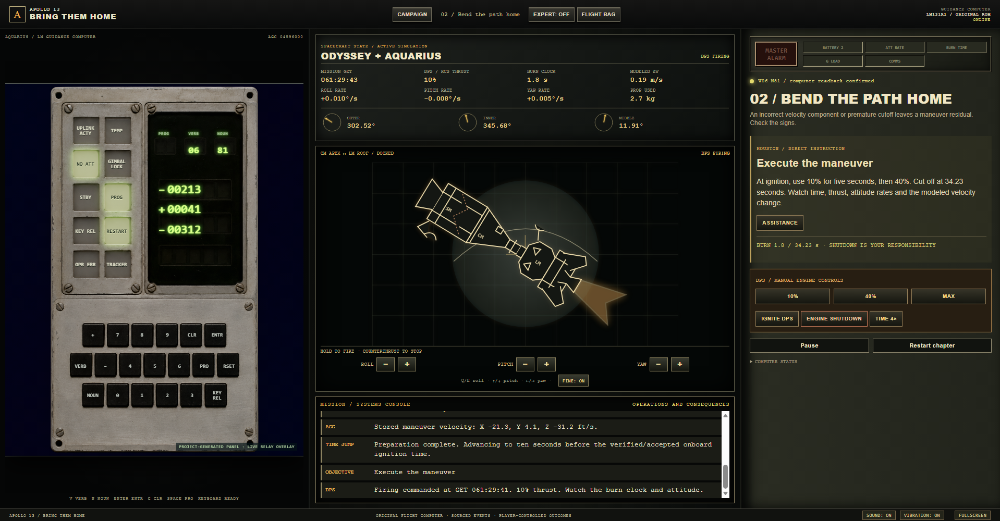

# Bring Them Home

**Work in progress:** the game is not finished, but you can
[play the current test build at helppox.com/apollo13](https://helppox.com/apollo13/).

An HTML5 Apollo 13 cockpit game. Operate the guidance computer, copy Houston's
instructions, consult flight manuals, and control the spacecraft through the
journey home. The DSKY runs original LM131R1 or reconstructed Manche72R3
command-module flight software in a WebAssembly emulator.



## The game

One short qualification leads into eight Apollo 13 events: platform transfer,
free return, thermal control, PC+2, a battery warning, manual correction, the
final RCS correction, and CM-only entry. Any chapter can be selected directly.

- Operate a live DSKY and verify the computer's actual readback.
- Copy sourced maneuver data from comms cards or consult original manual scans.
- Control rotation, counterthrust, throttle, ignition and cutoff. Watch the
  spacecraft, angle counters, velocity change and propellant use respond.
- Identify and acknowledge cockpit warnings. The console explains operations
  and consequences in English.
- Play in one screen, with fullscreen, expert mode, fine RCS control, sound and
  vibration controls. A reviewed original Apollo radio cue is bundled locally.

Desktop/laptop with a keyboard is the primary target. The cockpit scales to
smaller embeds; fullscreen is recommended.

## Run locally

Use **Node 22.12 or newer**; Node 24 LTS is recommended.

```sh
git clone https://github.com/apn201/Bring-them-Home.git
cd Bring-them-Home
npm ci
npm run dev
```

All commands run from the repository root. There is no nested application
directory. Open the HTTP address printed by Vite; opening `index.html` directly
from the filesystem will not run the game.

Development hot reload is disabled to preserve a running computer while files
are edited. Refresh manually to load changes. Completed chapters are remembered
locally; a live CPU session is not serialized.

## Controls

| Action | Control |
| --- | --- |
| VERB / NOUN | `V` / `N` |
| Enter / clear current entry | `Enter` / `C` |
| Numeric entry | Digits, `+`, `-` |
| KEY REL / RSET | `K` / `R` |
| PRO | Hold `Space` |
| Roll | `Q` / `E` |
| Pitch / yaw | Arrow keys |

Use counterthrust to stop a turn. Fine RCS control starts enabled. MARK PANEL
captures a moving readout for transmission. The flight bag explains entry
routines and links the relevant source documents.

Fast typing is buffered for the real ROM. A mismatched PAD remains at
verification until corrected or explicitly accepted as a deviation. Invalid
ignition-time data cannot authorize a burn. Entry offers a labeled **MODEL BANK
GUIDE**; slow time compression while maneuvering.

## Build, verify and publish

```sh
npm test
npm run assets:verify
npm run content:validate
npm run package:game
```

The packager creates:

| File | Purpose |
| --- | --- |
| `release/apollo13-html5.zip` | Runtime-only game for itch.io or static hosting |
| `release/apollo13-html5.sha256` | Archive checksum |
| `release/build-info.json` | Source commit and runtime-file inventory |

The ZIP places `index.html` at its root and includes the worker, both ROMs,
WebAssembly, image, audio and required notices. It excludes source maps, source
code, tests, dependencies and research acquisitions. Rebuild it locally; generated
release files are not committed.

For itch.io, choose **HTML Game**, upload the ZIP, and enable click-to-play and
fullscreen, or use a desktop embed of at least 1280×720. The same package works
on Apache at a site root or subpath. No backend or Node service is needed after
building. See the [OpenClaw Rocky Linux / Apache deployment prompt](docs/OPENCLAW_DEPLOY_PROMPT.md).

`npm run build` creates a normal production build in `dist/`.
`node tools/cockpit-browser-check.mjs` runs an isolated Windows Edge playthrough
without attaching to the player's browser. It covers rapid input, invalid PADs,
manual lookup, alignment, burns, alarms, local audio and CM entry setup.

## Repository layout

```text
src/                 Game, interface, emulator integration and local physics
public/              Shipped ROMs, WebAssembly, image, audio and notices
content/             Scenario evidence and replay fixtures
tests/               ROM, gameplay and physics regression tests
tools/               Verification, browser checks and release packaging
docs/                Sources, audio notes, design review and deployment guide
docs/archive/        Original planning and research-handoff documents
assets/software/     Retained third-party emulator and flight-software sources
```

Local acquisitions under `assets/documents/`, `assets/audio/` and `research/`
remain ignored. Original manual/source links require internet access; the
reviewed radio clip and gameplay assets are bundled.

## Historical sources and simulation scope

The computer's PAD storage, readbacks and alignment operations execute through
the ROM. The spacecraft environment uses a reduced local physics model. Full
historical P30/P40 checkpoints, complete orbital propagation and restored
P61–P67 entry guidance remain unfinished. The entry bank guide, tolerances and
some initial conditions are authored simulation rules. Scores are not validated
predictions of crew survival.

See [campaign sources and model boundaries](docs/CAMPAIGN_SOURCES.md),
[audio provenance](docs/AUDIO_PLAN.md), and the [design review](docs/DESIGN_REVIEW.md).
Original acquisitions and software identities are recorded in
[ASSET_MANIFEST.json](ASSET_MANIFEST.json) and [SOFTWARE_LOCK.json](SOFTWARE_LOCK.json).

## Licensing and notices

See [LICENSE](LICENSE) and [third-party notices](docs/THIRD_PARTY_NOTICES.md).
The bundled emulator carries GPL terms; original flight-software source headers
and reconstructed-software provenance are retained. The runtime distribution
includes [its notices](public/THIRD_PARTY_NOTICES.md) and the GPL text. Do not
describe the entire project as public domain. No NASA endorsement is claimed.
